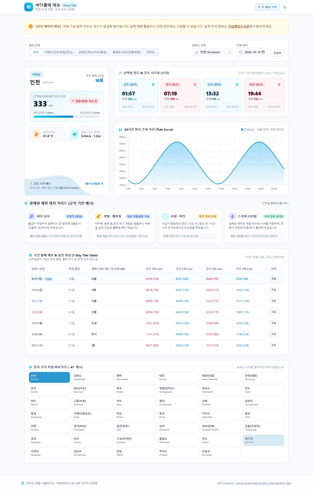

# 🌊 Korea Tide · 바다물때 데모

한국 연안의 조석 변화를 한 화면에서 탐색하는 **정적 웹 대시보드**입니다. 서해·남해·동해·제주 41개 지점을 선택해 만조·간조 시각, 24시간 조위 곡선, 7일 시각표와 레저 가이드 예시를 살펴볼 수 있습니다.

[](https://github.com/y5496694/-korea_tide/actions/workflows/check.yml)


**[웹 데모 열기](https://y5496694.github.io/-korea_tide/)** · [버그 제보](https://github.com/y5496694/-korea_tide/issues/new/choose) · [기여 안내](CONTRIBUTING.md) · [구조와 데이터](docs/ARCHITECTURE.md) · [개선 계획](docs/ROADMAP.md)

> **현재는 모의 데이터를 사용하는 프로토타입입니다.** 조위·만조·간조·수온·풍속·파고는 브라우저의 예시 계산으로 생성하며, 국립해양조사원 관측 데이터와 연결되어 있지 않습니다. 실제 출항·갯벌 진입·낚시·다이빙 등의 안전 판단에 사용하지 마세요. 실제 정보는 [국립해양조사원](https://www.khoa.go.kr/)에서 확인할 수 있습니다.



## 무엇을 할 수 있나요?

| 기능 | 현재 구현 |
| --- | --- |
| 해역·지점 선택 | 4개 해역 필터, 41개 지점 드롭다운 및 바로가기 |
| 날짜 탐색 | 기본 한국 날짜(KST), 날짜 선택, 오늘로 돌아가기 |
| 만조·간조 카드 | 선택일의 만조 2회·간조 2회 모의 시각과 높이 |
| 조위 곡선 | Chart.js로 그린 30분 간격 48개 표본, 툴팁 |
| 7일 시각표 | 선택일부터 7일 비교, 행을 클릭해 해당 날짜 조회 |
| 물때 표시 | 추정 월령에 따른 서해 7물·그 외 해역 8물 규칙 예시 |
| 해양 레저 카드 | 낚시·갯벌·서핑·스쿠버 규칙 기반 안내 예시 |
| 화면 테마 | 라이트·다크 모드 전환, 반응형 레이아웃 |
| MCP 진단 창 | 수동 `tools/list` POST 진단과 로컬 모의 응답 4종 |

## 바로 실행하기

별도 빌드, API 키, 패키지 설치 없이 실행합니다.

```bash
git clone https://github.com/y5496694/-korea_tide.git korea-tide
cd korea-tide
python -m http.server 8000 --bind 127.0.0.1
```

브라우저에서 **http://127.0.0.1:8000**을 엽니다. Windows에서 `python` 명령이 없다면 `py -m http.server 8000 --bind 127.0.0.1`을 사용하세요. 종료는 터미널에서 `Ctrl+C`입니다.

`index.html`을 직접 열어 화면을 볼 수도 있지만, MCP 요청을 시험할 때는 로컬 HTTP 서버를 권장합니다. Tailwind CSS·아이콘·Chart.js를 CDN에서 받으므로 화면을 정상적으로 표시하려면 인터넷 연결이 필요합니다.

1. 해역과 지점을 선택합니다.
2. 날짜를 바꾸거나 7일 시각표의 행을 클릭합니다.
3. 조위 곡선에 마우스를 올려 시간별 모의 조위를 확인합니다.
4. 오른쪽 위에서 테마를 전환하거나 MCP 진단 창을 엽니다.

오늘의 날짜와 시각 기준은 **KST(UTC+9)**입니다. 조위 카드에는 선택한 날짜의 KST 현재 시각에 해당하는 30분 표본을 표시합니다. 간조 잔여 시간은 오늘을 선택했을 때 화면 갱신 시점에 계산하며, 다른 날짜에서는 선택일 시각 예시로 표시합니다. 자동 갱신이나 알림 발송 기능은 없습니다.

## 등록된 지점

지점 ID는 이 앱의 내부 식별자입니다. 공식 관측소 코드나 실제 관측 장비의 설치 현황을 뜻하지 않습니다.

| 해역 | 수 | 지점 |
| --- | ---: | --- |
| 서해 | 12 | 인천, 강화도, 평택, 대산, 태안(안흥), 보령(대천), 군산, 변산(격포), 목포, 영광(안마도), 흑산도, 진도 |
| 남해 | 11 | 완도, 고흥(녹동), 여수, 광양, 남해, 삼천포, 통영, 거제도(장승포), 마산, 부산, 가덕도 |
| 동해 | 12 | 울산, 포항, 영덕(축산), 울진(후포), 삼척, 묵호(동해), 강릉(주문진), 양양, 속초, 고성(아야진), 울릉도, 독도 |
| 제주 | 6 | 제주항, 서귀포, 성산포, 한림, 추자도, 모슬포 |
| **합계** | **41** | `index.html`의 `STATIONS` 배열 기준 |

## 데이터는 어떻게 만드나요?

- **조석 시각·높이:** 지점별 고정 예시 값, 추정 월령, 시간 오프셋을 조합합니다. 실제 조화상수나 관측 자료로 보정한 예측 모델이 아닙니다.
- **조위 곡선:** 12.42시간 주기의 코사인 곡선에 작은 왜곡을 더합니다. 카드의 만조·간조 값과 곡선이 정확히 일치하도록 검증된 모델은 아닙니다.
- **물때:** 기준 시각에서 평균 삭망월을 적용한 월령 근사와 매핑 테이블을 사용합니다. 정식 음력 변환 및 지역별 물때 관습 전체를 구현하지 않습니다.
- **수온·풍속·파고:** 지점별 기준 값과 날짜에 따른 고정 규칙으로 생성합니다. 기상 API를 호출하지 않습니다.
- **레저 가이드:** 해역과 사리·조금 분류에 따른 문구 예시입니다. 실제 조류·시정·해상특보를 평가하지 않습니다.

세부 함수와 데이터 흐름은 [구조 문서](docs/ARCHITECTURE.md)를 참고하세요.

## MCP 기능의 범위

진단 창에 기본값으로 들어 있는 외부 URL은 기존 코드의 설정 예시입니다. 서버의 운영 상태나 도구 제공 여부를 보장하지 않습니다.

| 조작 | 실제 동작 |
| --- | --- |
| 페이지 열기 | 로컬 모의 데이터를 표시하며 MCP 서버에 자동 요청하지 않음 |
| 연결 테스트 | 입력한 URL에 JSON-RPC `tools/list`를 POST, 제한 시간 6초 |
| 진단 성공 | 유효한 `tools/list` JSON 응답을 로그에 표시, 대시보드는 모의 데이터 유지 |
| 진단 실패 | HTTP·JSON-RPC·응답 형식·네트워크 오류를 표시, 모의 데이터 유지 |
| 도구 예시 버튼 | `get_tide_forecast` 등 4개의 모의 응답을 로컬에서 생성, 원격 `tools/call` 없음 |

MCP의 초기화·버전 협상·인증·세션·SSE 처리가 없으므로 이 창은 완전한 MCP 클라이언트가 아닙니다. 정상 서버도 CORS나 초기화 요구 때문에 진단에 실패할 수 있습니다. 실제 연동 시에는 [MCP 수명주기 명세](https://modelcontextprotocol.io/specification/2025-06-18/basic/lifecycle)에 맞는 클라이언트와 서버 측 데이터 연동이 필요합니다. API 키나 토큰은 공개 HTML에 넣지 마세요.

## 기술과 파일 구조

앱은 HTML, CSS, 바닐라 JavaScript로 작성했습니다. Tailwind CSS Play CDN, Phosphor Icons, Chart.js를 외부에서 불러옵니다. 서버·데이터베이스·번들러는 없습니다.

```text
.
├── index.html                  # 화면, 스타일 설정, 예시 데이터, 계산·이벤트 처리
├── README.md
├── CONTRIBUTING.md             # 실행·검증·변경 제출 안내
├── docs/
│   ├── ARCHITECTURE.md          # 데이터 흐름과 함수 역할
│   ├── ROADMAP.md               # 실제 데이터 연동 등 후속 과제
│   └── images/dashboard.png    # 실제 브라우저 실행 화면
├── tests/tide.test.cjs          # Node.js 기본 테스트 러너
└── .github/
    ├── workflows/check.yml     # JavaScript 구문·회귀 검사
    ├── ISSUE_TEMPLATE/          # 버그·기능 제안 양식
    └── pull_request_template.md
```

## 검증하기

개발 검증에는 **Node.js 22 또는 24**를 사용합니다. 추가 패키지는 필요 없습니다.

```bash
node --test
```

GitHub Actions에서도 같은 검사를 실행합니다. 검사는 인라인 JavaScript 구문, 41개 지점의 데이터 조건, 월령 범위, 조석 이벤트와 곡선 형태, 한국 날짜·다른 시간대에서의 날짜 일관성을 확인합니다. 실제 관측치와의 정확도 검증을 의미하지 않습니다. 화면과 MCP 동작의 수동 확인 절차는 [기여 안내](CONTRIBUTING.md)에 있습니다.

## 배포와 다음 단계

현재 GitHub Pages는 `main` 브랜치의 루트(`/`)를 게시합니다. 별도 빌드 산출물 없이 `index.html`을 서비스합니다. Pages 설정 방법은 [GitHub 공식 문서](https://docs.github.com/en/pages/getting-started-with-github-pages/creating-a-github-pages-site)를 참고하세요.

우선 개선 과제는 **공식 데이터 API 연동**, **완전한 MCP 클라이언트**, **정확한 음력·물때 처리**, **운영용 CDN 의존성 정리**입니다. 완료된 기능과 계획은 [로드맵](docs/ROADMAP.md)에서 구분합니다.

## 라이선스

현재 이 저장소에는 별도의 라이선스가 지정되어 있지 않습니다. 재사용·재배포 조건은 저장소 소유자에게 확인하세요. 외부 라이브러리에는 각 프로젝트의 라이선스가 적용됩니다.
