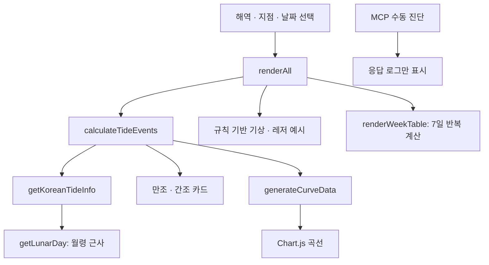

# 구조와 데이터

## 실행 구조

`index.html`에 화면 마크업, Tailwind 설정, CSS, 지점 예시 데이터와 앱 로직을 함께 둡니다. 브라우저가 CDN 라이브러리를 로드한 뒤 `DOMContentLoaded`에서 KST 기준 날짜와 지점 목록을 초기화하고 `renderAll()`을 호출합니다.

## 주요 데이터와 함수

| 이름 | 역할과 한계 |
| --- | --- |
| `STATIONS` | 41개 지점. 내부 ID·한영 이름·해역·예시 조위 범위·기상 기준 값. 좌표와 공식 관측소 코드는 없음 |
| `formatDateInput` | 선택일의 연·월·일을 유지해 날짜 입력값으로 변환. UTC 변환으로 전날이 되는 문제를 방지 |
| `getKstNow` | 실행 환경 시간대와 관계없이 한국 날짜와 시간을 반환 |
| `getLunarDay` | 2024-01-11 기준 시각과 29.53058867일 주기로 월령을 근사. 기준일 이전도 양의 나머지로 처리 |
| `getKoreanTideInfo` | 월령 기반 날짜 번호를 7물/8물 매핑에 적용. 정식 음력 달력은 제공하지 않음 |
| `calculateTideEvents` | 고정 오프셋과 0.84시간/일 지연을 사용해 하루 4개 이벤트 생성·정렬. 일부 지점은 기본 오프셋 사용 |
| `generateCurveData` | 00:00~23:30, 30분 간격 48개 값. 고정 12.42시간 주기와 작은 왜곡으로 생성 |
| `renderAll` | 지점·조석·기상 예시·곡선·레저 카드·7일 표 갱신 |
| `populateStationDropdown` / `selectStation` | 해역 필터 및 전체 지점 바로가기 처리. 필터 밖 바로가기를 고르면 전체 해역으로 전환 |
| `testMcpConnection` | 수동 HTTP POST와 응답 형식 검사. 데이터 공급 함수로 사용하지 않음 |

## 시간과 표시 규칙

- 선택일은 브라우저의 날짜 객체에 달력 날짜로 보관합니다. 계산 시에는 해당 날짜의 KST 자정으로 변환해 환경 시간대에 따른 월령 차이를 줄입니다.
- 오늘 버튼과 현재 시각은 `getKstNow()`를 사용합니다.
- 오늘의 남은 간조가 없으면 다음 날 모델을 계산해 첫 간조를 표시합니다. 과거·미래 날짜는 잔여 시간 대신 선택일 예시를 표시합니다.
- 시각과 잔여 시간은 렌더링 시점의 값입니다. 실시간 스트림, 자동 새로고침, 백그라운드 알림은 없습니다.
- 테마와 선택 상태는 메모리에만 보관합니다. 새로고침하면 초기화됩니다.

## 네트워크 경계

페이지 로딩 시 CDN 3곳에서 화면 의존성을 가져옵니다. MCP 요청은 사용자가 연결 테스트를 누를 때만 전송합니다. 진단은 `tools/list` JSON 응답만 처리하며, MCP 초기화·인증·세션·SSE를 구현하지 않습니다. 예시 도구 버튼은 네트워크 요청 없이 JSON 로그를 만듭니다.

실제 API를 연결할 때는 출처, 관측 시각, 시간대, 단위, 조위 기준면, 지점 코드, 실패 상태를 명시하고 모의 값과 구분해야 합니다. 브라우저에 비밀 키를 저장하지 않는 서버 계층이 필요합니다.

## 검증 범위

`tests/tide.test.cjs`는 앱의 인라인 스크립트를 직접 읽어 구문을 검사하고, DOM 초기화 이전의 계산 함수를 VM에서 실행합니다. 데이터의 유일성·유효 범위·시간 정렬·표본 수·날짜 경계와 시간대 일관성을 검사합니다. 검증은 시뮬레이션의 소프트웨어 동작에 한정하며 천문학적 정확도를 보증하지 않습니다.
